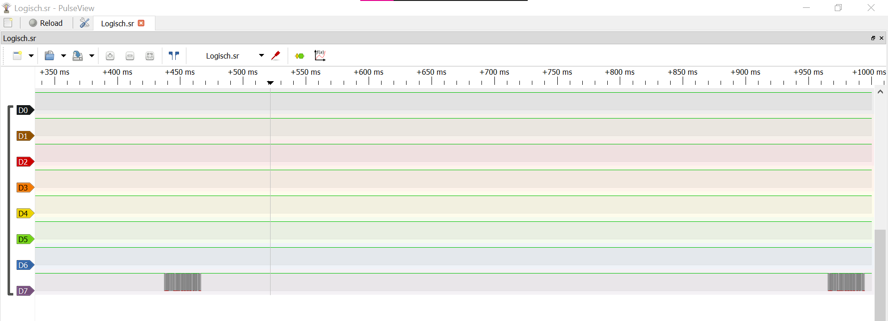
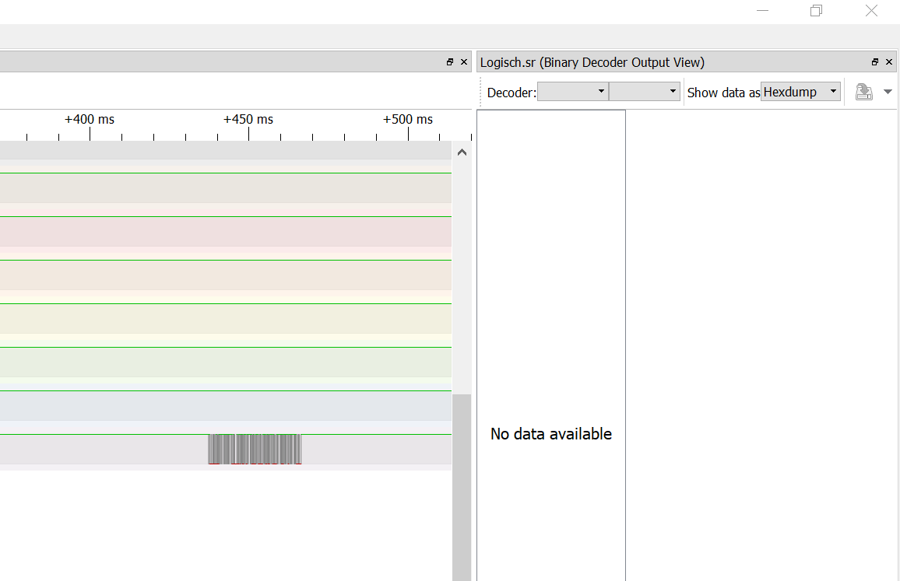
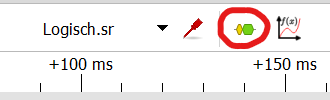
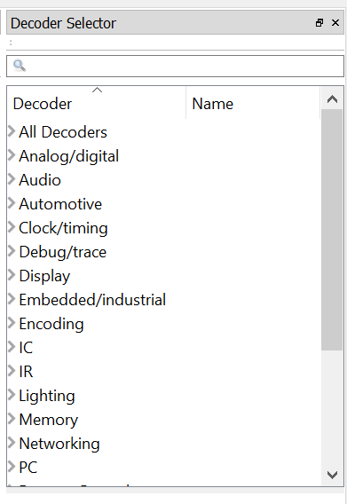
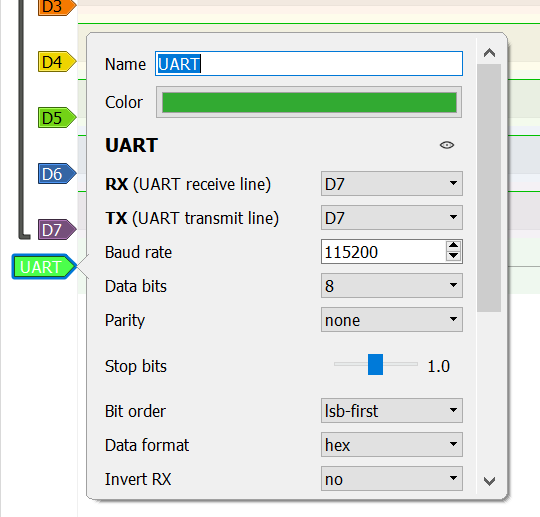
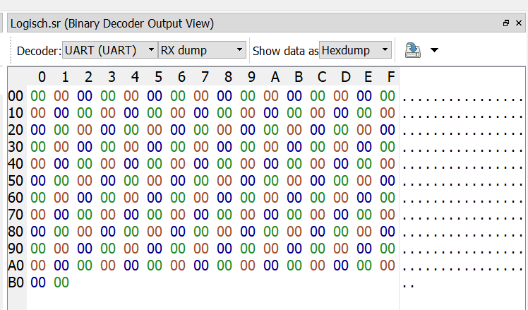
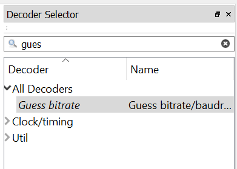
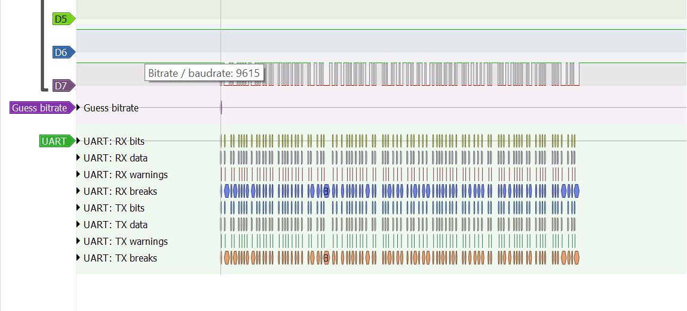
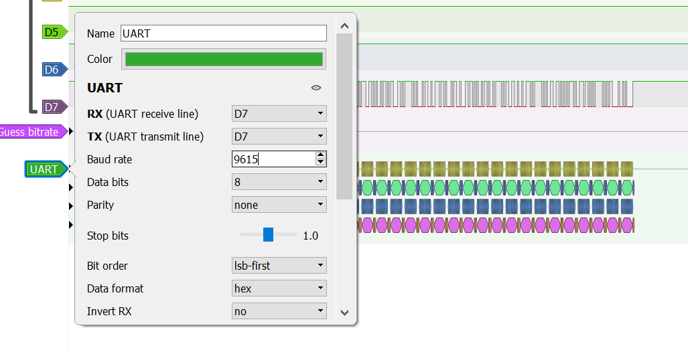
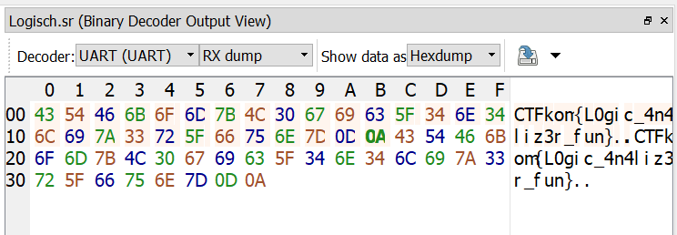

`This is a quite easy Logic Analyzer challenge.
Open the file with PulseView https://sigrok.org/wiki/PulseView and find the corresponding decoder!
There is only one problem. I have completely forgotten the baud rate I used.
Dont forget to use the Binary Decoder Output View!`

We have received a file named "Logisch.sr", which is a sigrok file. Sigrok is an open source signal analysis software 
which is used for things such as logic analyzers and oscilloscopes. We'll use PulseView as advised to open our file.

When opening the file, it looks a little something like this:

In order to retrieve any data, we have to turn on the binary decoder output view:

However, there is no data here, because we haven't added any decoders yet.

This can be done by clicking this icon

and it gives us this menu to pick from

The challenge description mentioned something about baud rate, which in this case happens to be about UART, or a Universal asynchronous receiver-transmitter, which uses baud as a form of measurement. A baud rate is the measure of the number of changes to the signal (per second).

We'll select it from the decoder tab. Don't forget to assign the UART decoder to channel D7, which is where our data is located!

However, we don't have any data still.

This is because of the incorrect baud rate. As mentioned, we don't remember the correct baud rate. So what do we do then? Luckily, PulseView has a function for this, and it's called Guess bitrate:

This decoder will guess the bitrate for you, based on the data we have. In this case, it gives us a baud rate of 9615.

We can now go back and edit the UART decoder in order to set the baud rate as 9615.

And voilà, the data has changed! It's readable now, and it's displaying the flag!

`CTFkom{L0g1c_4n4liz3r_fun}`

